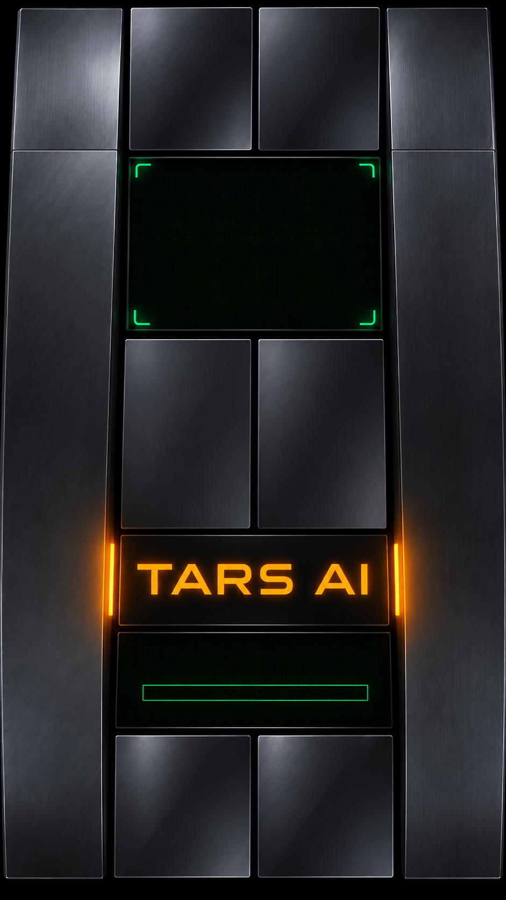

# TARS-AI

**Your own local-first AI assistant.**

Modular hardware styling · Offline GGUF models · TARS-inspired personality · Android preview

[Source code](https://github.com/Barroni1977/TARS-Android) · [Development branches](https://github.com/Barroni1977/TARS-Android/branches) · [Open-source licence](LICENSE)

## What is TARS-AI?

TARS-AI is a independently branded React Native assistant built on the
open-source PocketPal AI codebase. Our development focus is a distinctive
TARS-style Android interface and on-device language-model inference.

- **Offline chat:** download a compatible GGUF model and run normal text
  conversations locally without a cloud inference service.
- **Model management:** import, download and select language models;
  device memory and storage limits still matter.
- **TARS interface:** metallic startup artwork with animated local diagnostics,
  green waveform, amber accents and a matching command deck.
- **First-run setup:** choose a mission and a model using TARS-branded
  onboarding rather than the original cartoon illustrations.
- **Optional online features:** model downloads, account services, web/search
  tools, remote inference, benchmark submission and some voices may contact
  external services when used. Do not assume these features are offline.
- **Current development:** the startup display's humour, honesty and sarcasm
  readouts are decorative; full behavioural controls and a dedicated TARS
  voice are future work.

TARS-AI is currently a development project, not an App Store or Google Play
listing. Avoid third-party listings claiming to be this build.

## Android preview builds

Use the **Artifacts** section of successful Android jobs in
[GitHub Actions](https://github.com/Barroni1977/TARS-Android/actions).
The preview package uses `com.barroni1977.tarsai.preview` so it is separate
from an existing production installation. These previews may use temporary
signing, so updating a previous preview APK might require additional care.
Export conversations and models before removing any installed app.

Do not merge experimental branches or produce test APKs without approval.

## Project structure

| Area | Purpose |
| --- | --- |
| `src/components/TarsBootScreen.tsx` | Original startup artwork presentation |
| `src/components/TarsApprovedArtOverlay.tsx` | Animated screen and progress bar |
| `src/screens/OnboardingScreens/` | First-run TARS-AI activation and model setup |
| `src/components/TarsBrandMark/` | App's original modular hardware emblem |
| `src/store/` | Local model, profile and conversation state |
| `src/services/` | On-device inference, audio and optional services |
| `android/app/src/main/res/` | Android launcher and platform resources |
| `ios/PocketPal/` | Existing iOS native project path retained for build compatibility |

Some internal names still contain `pocketpal`, `pal` or `Pip` because
they identify native modules, third-party packages, persisted keys, database
entities, API contracts or automated-test fixtures. They are not the TARS-AI
brand shown to users. Do not rename or delete these identifiers without a
versioned migration and test plan.

## Privacy and connected services

Normal chat using a downloaded local model is processed on-device. Other
features can connect to external providers, and their data flows depend on
the selected service and consent. This repository does not currently
guarantee that every app feature runs without networking or tracking.
Review the source and permissions before enabling optional connected
features.

## Upstream acknowledgement

TARS-AI is derived from the open-source
[PocketPal AI project](https://github.com/a-ghorbani/pocketpal-ai).
Its original authors retain their applicable copyright notices and the
repository preserves the MIT licence and third-party attribution. The
name, user-facing theme, and TARS-branded interface in this fork are
separate from the upstream project; no official association is implied.

Model files, voice models, and any fictional character likenesses may have
their own distribution and intellectual-property restrictions. Do not
redistribute third-party voice recordings or film-derived audio without
the necessary permissions.

## Contributing and verification

This repository contains native Android/iOS and React Native projects.
Before merging a UI or branding change, run lint, TypeScript, unit tests,
Android resource linking, install checks and relevant first-run tests.
Screenshots and release metadata must be newly captured and approved for
TARS-AI before publishing.

This fork is a work in progress. Please
[report an issue](https://github.com/Barroni1977/TARS-Android/issues)
if a TARS-AI screen still exposes inherited PocketPal branding.
